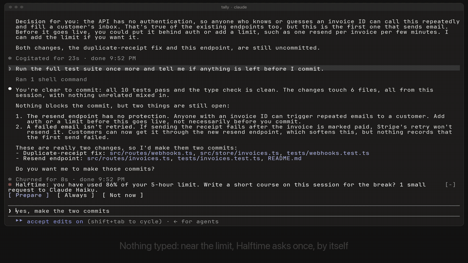

<h1 align="center">
  <picture>
    <source media="(prefers-color-scheme: dark)" srcset="assets/title-dark.svg">
    
  </picture>
</h1>

<p align="center">
  <b>Hit your Claude usage limit? Take a short course on what Claude just did in your project.</b>
</p>

<p align="center">
  <a href="#install"></a>
  <a href="LICENSE"></a>
</p>

<p align="center">
  
</p>

<p align="center"><sub>Recorded in a real Claude Code session on a small demo project. Halftime asks and opens by itself; only the usage numbers were staged for the recording.</sub></p>

When Claude Code stops for a usage limit, you usually reach for your phone. Halftime opens a pane beside your session instead, with a short course on what Claude just did in your project, like a Coursera unit written about your own code. You come back understanding the work, not just owning it.

It works for any kind of session: building a feature, fixing a bug, ML or science research, web research, a release, firefighting in production, a refactor, even cleaning up your laptop. It reads what helper agents did, and what happened before a long conversation was summarized.

## What you get

| | |
|---|---|
| **A briefing** | Where things stand: the issue, what is done, what is still open, the session in numbers, and one thing you probably did not know. |
| **Lessons on real topics** | Each lesson is one topic from your project, in four short cards: what it is, where it lives in your project (with the real diff), what Claude did with it and why, and the takeaway. |
| **Guess first** | When Claude made a choice, you guess what you would have done before you see what it chose, why, and what it costs you. |
| **Quizzes and a score** | A check after each lesson and a final quiz about why and how, not trivia. Answered questions are never asked again. |
| **A badge to share** | Finish a course and get your score, a badge, and a share card. Your project's name stays out unless you add it. |
| **A course that grows** | Each break adds new lessons; finished ones stay done. Questions you missed come back as a one-minute review at your next break. |
| **Session notes, free** | Without any request: what you asked, what helpers reported, what broke, what you approved, a map of your files, and a replay. |
| **In your browser too** | Press <kbd>o</kbd> on a course to open it as a full-size page in your browser: one idea per screen, answers checked as you go, and a clock until Claude is back. It's one file on your computer that loads nothing from the internet, and it starts from your progress in the pane. |
| **Prompts for later** | Save "add a test for this" with one key. When the limit resets, it is placed in your prompt box and is never sent for you. |

## Install

In Claude Code:

```
/plugin marketplace add aryawidjaja/halftime
/plugin install halftime@halftime
```

Or from your shell:

```bash
claude plugin marketplace add aryawidjaja/halftime
claude plugin install halftime@halftime
```

That is all. The installer may say some options are not set yet. They all have defaults, so there is nothing to configure.

> [!NOTE]
> Halftime is a mod: a plugin that ships a hooks module. Mods need **Claude Code 2.1.287 or newer** in the terminal, or **2.1.286 or newer** in the desktop app. Check with `claude --version`, and update with `claude update`.

## Try it

Open any session where Claude changed some code, then:

| Command | |
|---|---|
| `/halftime` | Opens the pane, limit or not. |
| `/halftime simulate 3` | Pretends a limit was hit and resets in 3 minutes, so you can see the whole flow. Nothing is sent to Claude. |
| `/halftime simulate ask` | Shows the question Halftime asks near a limit. The course is written only if you press Prepare or Always. |
| `/halftime close` | Closes the pane. |

When a real limit hits, Halftime opens by itself on wide terminals. On narrower ones it adds a line above your prompt with an **Open Halftime** button. The status line counts down to the reset.

> [!TIP]
> Not seeing the pane in a wide terminal? Claude Code's diff panel shares the same side dock and can cover it. Type `/diff` to hide that panel.

Click the pane (or press <kbd>ctrl</kbd>+<kbd>x</kbd> <kbd>tab</kbd>) and use the keys:

| Keys | |
|---|---|
| <kbd>s</kbd> | Start or continue the course |
| <kbd>1</kbd> <kbd>2</kbd> <kbd>3</kbd> | Open a lesson. In a question, pick an answer. |
| <kbd>n</kbd> <kbd>b</kbd> <kbd>m</kbd> | Next, back, course home |
| <kbd>k</kbd> <kbd>d</kbd> | I know this (skip ahead), go deeper |
| <kbd>a</kbd> | Save as a prompt for later |
| <kbd>g</kbd> <kbd>v</kbd> <kbd>l</kbd> <kbd>p</kbd> | Write the course, review, your courses, prompts |

In the desktop app and VS Code, click instead.

## It stays out of your way

| | |
|---|---|
| **Model requests** | Never without asking. At 85% of a limit window, after a turn ends, one line above your prompt asks: **Prepare**, **Always** or **Not now**. It does not block anything, it asks once per window, and it stops asking above 95%. The course is one request to **Claude Haiku**, the lightest model, at low effort. It reads a compact digest of the session, never the whole conversation, so the cost stays small however long the session is: about one cent at API prices, measured across 14 real sessions. **Always** is remembered and turned off in the pane with one press. Nothing is requested during a limit, and nothing twice for the same window. You can also press <kbd>g</kbd> in the pane any time Claude is not paused. |
| **Background work** | Below the limit: one comparison of the usage numbers Claude Code already reports, after each turn. No timers, no polling, no file watching. During a limit: a status update once a minute and one timer for the reset. |
| **Reading** | Your transcript and your helper agents' transcripts (up to 30), once per limit or when you open the pane. Only the files Claude changed (up to 18, each under 400 KB), your settings files, and the descriptions of packages you installed. |
| **Blocking** | Never. The pane sits beside your session, and every hook fails open. |

### When the limit resets

Claude Code already continues your session by itself after a reset ("Continue automatically at usage limit", on by default). Halftime does not compete with it. It sends one continue only when all of these hold:

- the limit cut off your last turn;
- 150 seconds after the reset, no turn has started;
- you are not typing;
- you have not turned that setting off.

It sends at most one per limit.

## Settings

Change these in `/config` → Plugins → halftime.

| Option | Default | |
|---|---|---|
| `autoOpen` | on | Open the pane when a limit hits. Off: only `/halftime` opens it. |
| `prebake` | off | Write the course without asking, once per limit window (the same as answering **Always**). |
| `prebakeAt` | 85 | The percent of the window at which Halftime asks, or writes. |
| `model` | haiku | `haiku`, or `sonnet` for richer lessons at about twenty times the cost. |
| `autoContinue` | on | The single fallback continue described above. |
| `minWaitMinutes` | 5 | For shorter waits, only the countdown shows. |

## Privacy

Halftime keeps everything on your machine: courses, scores, badges and saved prompts live in Claude Code's plugin store, per project. The one request goes through Claude Code to Claude Haiku, on your own account, like any other turn. Before it is sent, anything that looks like a secret (API keys, tokens, passwords, private keys, credentials in URLs) is removed, and the same filter runs on everything the pane shows. Sharing happens only when you press Copy or Save, and the share card leaves your project's name out unless you turn it on. A course you open in the browser is saved as one file in `~/.claude/halftime/`; its page blocks every network request, and your answers there stay in that browser.

### What Halftime does on your machine

Everything Halftime reads, sends, writes or runs, in one place.

**What it reads**
- **Your session:** the transcript, your helper agents' transcripts, and the summary Claude Code writes when a long conversation is compacted.
- **Changed files:** up to 18 of the files Claude changed in the session, each under 400 KB, so lessons can show the real change.
- **Your settings:** `.claude/settings.json` and `.claude/settings.local.json` in the project, and Claude Code's `settings.json`. From these it reads only two things:
  - `permissions.allow`, to show in the session notes which permission rules you approved;
  - `autoContinueAtUsageLimit`, to know whether you turned off Claude Code's own continue.

  It reads no other setting, no credentials, and no `.env` file. The only `.env` contents it sees are in the transcript, when Claude wrote such a file, and it keeps the variable names only, never the values.
- **Your home folder path** (`HOME`, or `USERPROFILE` on Windows), to know where to save files.

**What it sends, and where**
- **One request to Claude Haiku**, made through Claude Code's own model API (`$.model.complete`), on your account, like any other turn.
  - It's sent only after you choose Prepare or Always, or press <kbd>g</kbd>.
  - It contains a compact digest of the session: your requests, Claude's explanations, the files changed, the problems hit, and where things stand.
  - Anything that looks like a secret is removed first.
- **Nothing else.** Halftime has no server, no telemetry and no MCP server.

**Prompts it puts in your prompt box**
- **Prompts you saved:** when the limit resets, the first prompt you saved in the pane is placed in your prompt box (`$.prompt.fill`). It is never sent for you.
- **The one prompt it can submit:** if Claude Code did not continue by itself after a reset, Halftime submits this exact text once:

  > Your usage limit has reset. Please continue the task you were working on when it was reached.

  This only happens when the `autoContinue` setting is on and Claude Code's own `autoContinueAtUsageLimit` is not off.

**What it writes**
- **Courses, scores and saved prompts:** to Claude Code's plugin store.
- **When you press <kbd>o</kbd>:** one HTML file per course, at `~/.claude/halftime/<project>/<course>.html`. The page blocks every network request.
- **When you share and the clipboard is unavailable:** a text file and a badge image, `halftime-<date>-<id>.txt` and `.svg`, in your Downloads folder (or home folder).
- **Nothing else:** Halftime never writes settings, instructions, build or start-up files.

**What it runs**

Only when you press <kbd>o</kbd>, to open that one HTML file in your browser:
- `uname -s`, to tell macOS from Linux;
- then `open <file>` on macOS, `xdg-open <file>` on Linux, or `explorer.exe <file>` on Windows. No shell, no network tool, no script.

**What its hooks do**
- **`command.run`:** answers only its own `/halftime` command and passes every other command on unchanged.
- **`classic.StopFailure`:** reads only the error type and the transcript path, to notice a usage limit, and passes the event on unchanged.
- **The other events it listens to** (`session.start`, `session.end`, `session.measure`, `turn.start`, `turn.complete`, and the drawing of its pane and the line above your prompt) are passed on unchanged.
- **Permissions:** it never makes or changes a permission decision.

## Limitations

- **The course needs one request**, which Halftime asks about near a limit, or which you start with <kbd>g</kbd>. During a limit Claude cannot write it, so the pane offers to write the next one in time. The free session notes are always there.
- **Long conversations:** for the part before Claude Code summarized the conversation, Halftime reads that summary, not the full history.
- **Claude Code's diff panel** shares the terminal's side dock and can cover the pane in a wide terminal. Type `/diff` to hide it.
- **Sharing in VS Code** saves the share text and a badge image to your Downloads folder, since plugins cannot reach the clipboard there yet.
- **Browser answers stay in the browser.** The page can't send them back to Halftime, so the pane keeps its own progress and its review deck doesn't see misses made in the browser. Over SSH there is often no browser to open; Halftime then tells you where the file is.
- **No pane in `-p` runs or cloud sessions.** Panes are drawn in the terminal, the desktop app's Code tab and the VS Code extension. In VS Code the file map is drawn as text.

## Development

```bash
claude plugin validate --strict .   # manifest and hooks module
claude plugin test .                # tests/*.test.ts(x) against the engine's test kit
claude --plugin-dir .               # a session with Halftime loaded; reloads on save
```

<details>
<summary>How the code is laid out</summary>

```
hooks/index.tsx        every engine call: events, timers, the command, the request, the pane and band hooks
hooks/views.tsx        which screen to draw, and the line above the prompt
hooks/learn.tsx        the course: home, briefing, lessons, quiz, score, badge, review, library
hooks/notesviews.tsx   the free session notes
hooks/ui.tsx           pieces every screen shares
hooks/notes.ts         chapters of the session notes, pure
hooks/build.ts         assembles what the session holds from what index.tsx read
hooks/lib/extract.ts   transcript → changes, bugs, approvals, helpers, the earlier summary
hooks/lib/digest.ts    the digest sent for the course, secret removal, the kind of session
hooks/lib/teach.ts     the course prompt, validation and scoring
hooks/lib/store.ts     the course library and review deck, checked on the way in
hooks/lib/graph.ts     import graph and layout
hooks/lib/draw.ts      the map as SVG (desktop) or a cell grid (terminal)
hooks/lib/prebake.ts   reading the reply, mixing answer positions, when to ask
hooks/lib/web.ts       the course as a web page, and where it is saved
hooks/lib/page.ts      that page, as one raw HTML string
types/index.d.ts      data types and the session-state contract
```

</details>

## License

[MIT](LICENSE)
